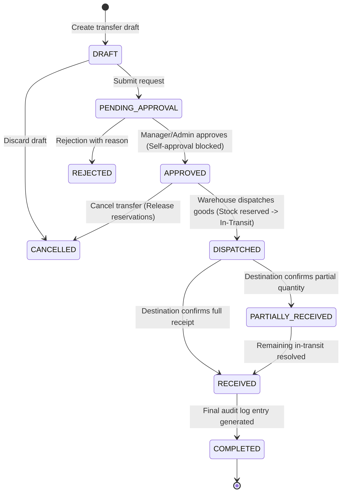

# Stock Transfer State Machine Specification

## 1. State Lifecycle

---

## 2. Invariant & Concurrency Rules

1. **Reservation on Approval:**  
   When a transfer moves to `APPROVED`, the requested quantities are immediately locked into `stock_balances.reserved` at the source location.
   $$\text{Available Quantity} = \text{On Hand} - \text{Reserved}$$
   Approval fails with a `400 INSUFFICIENT_STOCK` error if $\text{Available Quantity} < \text{Requested Quantity}$.

2. **Self-Approval Guard:**  
   A user with `requested_by == current_user.id` cannot approve their own transfer, even if they have `MANAGER` or `ADMIN` role.

3. **Dispatch Operation:**  
   - Deducts quantity from source `on_hand` and `reserved`.
   - Generates `TRANSFER_OUT` stock movement at source location.
   - Status updates to `DISPATCHED`. Goods are marked `IN_TRANSIT`.

4. **Receipt Operation:**  
   - Destination location staff enters received quantity.
   - If `received_qty == expected_qty`: Status becomes `RECEIVED`.
   - If `received_qty < expected_qty`: Status becomes `PARTIALLY_RECEIVED`. A discrepancy record is registered for audit.
   - Increments destination `on_hand`.
   - Generates `TRANSFER_IN` movement at destination with source unit cost.
   - Recalculates destination weighted average cost.
